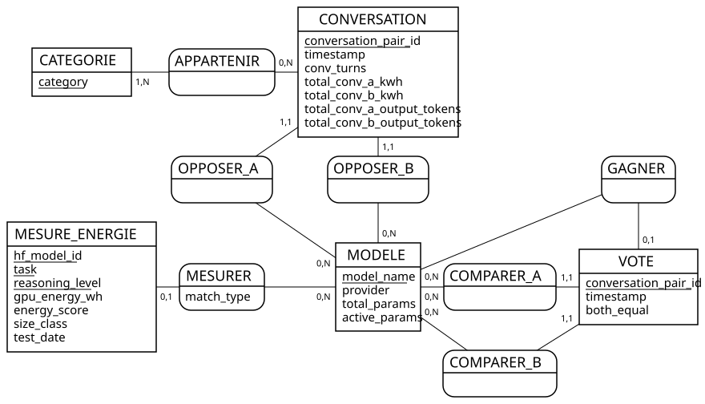

# Modèle de données (C4)

Base : Google BigQuery, projet `certif-ai-energy`, dataset `ai_energy` (région EU).
Les tables ci-dessous forment la **couche silver** de l'architecture médaillon :
données nettoyées par `src/clean.py`, chargées par `src/load_bigquery.py`.

## 0. Choix technologique : SQL (BigQuery) plutôt que NoSQL

| Besoin du projet | Réponse |
|---|---|
| Nature des données | tabulaires, schéma stable et connu (colonnes typées) → **modèle relationnel** |
| Liens entre entités | modèles, conversations, votes, mesures reliés par des clés → **jointures SQL** |
| Usage | agrégations (moyennes, scores, comptages par modèle, par catégorie) → point fort du SQL |
| Volume | ~1,4 million de lignes, appelé à croître chaque mois → base **orientée colonnes** et serverless (BigQuery), qui lit seulement les colonnes utiles |
| Accès des outils | l'API et d'autres outils (BI, notebooks) interrogent en SQL standard |
| Hébergement | région EU, gestion des droits par compte de service (RGPD) |

Une base NoSQL orientée documents (MongoDB…) conviendrait à des données sans schéma fixe ou très imbriquées (par exemple le texte complet des conversations). Ici, ces données ne sont pas collectées (minimisation RGPD), et tout le reste est tabulaire et relié : le relationnel est le choix naturel.
Pourquoi BigQuery plutôt qu'une base relationnelle classique (PostgreSQL, SQLite) : pas de serveur à administrer, lecture par colonnes adaptée aux agrégations sur des centaines de milliers de lignes, et intégration directe avec les fichiers parquet.

## 1. MCD — modèle conceptuel

Source : [`diagrammes/mcd.mcd`](diagrammes/mcd.mcd), dessiné avec Mocodo (notation Merise).
Régénérer : `mocodo --input docs/diagrammes/mcd.mcd`

| Association | Cardinalités | Lecture |
|---|---|---|
| OPPOSER_A / OPPOSER_B | CONVERSATION 1,1 — MODELE 0,N | une conversation oppose exactement un modèle A et un modèle B ; un modèle participe à 0 ou plusieurs conversations |
| APPARTENIR | CONVERSATION 0,N — CATEGORIE 1,N | une conversation a 0 ou plusieurs catégories ; une catégorie existe parce qu'au moins une conversation l'utilise |
| COMPARER_A / COMPARER_B | VOTE 1,1 — MODELE 0,N | un vote compare exactement un modèle A et un modèle B |
| GAGNER | VOTE 0,1 — MODELE 0,N | un vote désigne 0 gagnant (égalité) ou 1 gagnant |
| MESURER | MESURE_ENERGIE 0,1 — MODELE 0,N | une mesure AI Energy Score concerne 0 modèle ComparIA (50 des 66 modèles mesurés n'y sont pas) ou 1 ; un modèle a 0 ou plusieurs mesures (tâches, niveaux de raisonnement). Attribut de l'association : `match_type` |

**Choix de modélisation**
- **Pas d'association entre VOTE et CONVERSATION** : les deux fichiers ComparIA partagent `conversation_pair_id`, mais 2,9 % des votes n'ont pas de conversation publiée. Le vote porte donc lui-même les deux modèles du duel, ce qui lui permet d'exister sans sa conversation.
- **Identifiant de MESURE_ENERGIE composé** (`hf_model_id`, `task`, `reasoning_level`) : un même modèle est mesuré sur deux tâches, et parfois à trois niveaux de raisonnement.

## 2. MLD — modèle logique

Règles de passage appliquées :
- **association 1,1 ou 0,1** → la clé de l'entité « N » devient **clé étrangère** du côté 1,1 / 0,1, avec les attributs de l'association ;
- **association n-n** → nouvelle table dont la clé est le couple des deux identifiants.

<u>Souligné</u> = clé primaire · `#` = clé étrangère

- **models** (<u>model_name</u>, provider, total_params, active_params)
- **conversations** (<u>conversation_pair_id</u>, timestamp, conv_turns, total_conv_a_kwh, total_conv_b_kwh, total_conv_a_output_tokens, total_conv_b_output_tokens, #model_a_name, #model_b_name)
- **conversation_categories** (<u>#conversation_pair_id, category</u>) — association APPARTENIR ; l'entité CATEGORIE, qui n'a qu'un libellé, n'a pas besoin de table propre
- **votes** (<u>conversation_pair_id</u>, timestamp, both_equal, #model_a_name, #model_b_name, #chosen_model_name)
- **energy_measures** (<u>hf_model_id, task, reasoning_level</u>, gpu_energy_wh, energy_score, size_class, test_date, #model_name, match_type)

## 3. MPD — modèle physique (BigQuery)

Script complet : [`sql/create_tables.sql`](../sql/create_tables.sql).

| Table | Lignes (11/10/2026) | Clé primaire | Clés étrangères |
|---|---|---|---|
| models | 122 | model_name | — |
| conversations | 409 977 | conversation_pair_id | model_a_name, model_b_name → models |
| conversation_categories | 884 364 | (conversation_pair_id, category) | conversation_pair_id → conversations |
| votes | 149 183 | conversation_pair_id | model_a_name, model_b_name, chosen_model_name → models |
| energy_measures | 80 | (hf_model_id, task, reasoning_level) | model_name → models |

Types utilisés : `STRING`, `INT64`, `FLOAT64`, `BOOL`, `TIMESTAMP`, `DATE`.

**Spécificités de BigQuery**
- **Clés « NOT ENFORCED »** : BigQuery accepte la déclaration des clés primaires et étrangères mais ne les vérifie pas. Elles documentent le modèle et aident l'optimiseur de requêtes. La cohérence est garantie en amont par `clean.py` : doublons retirés, `check_mapping`, modèles des votes ajoutés à `models`. Une clé déclarée mais fausse peut faire renvoyer des résultats faux : c'est pourquoi aucune clé étrangère n'est déclarée entre votes et conversations.
- **`NOT NULL` vérifié** : contrairement aux clés, les contraintes `NOT NULL` et les types sont vérifiés au chargement. `load_bigquery.py` charge les données avec le schéma de la table : une valeur vide ou un mauvais type fait échouer le chargement.
- **Contrôles du chargement** : avant chaque table, `load_bigquery.py` vérifie que la clé primaire est unique (BigQuery ne le ferait pas) ; après, le nombre de lignes dans BigQuery est comparé au fichier local.
- **Pas d'index** : BigQuery est une base orientée colonnes, sans index. Perspective si le volume augmente : partitionner `conversations` et `votes` par date.
