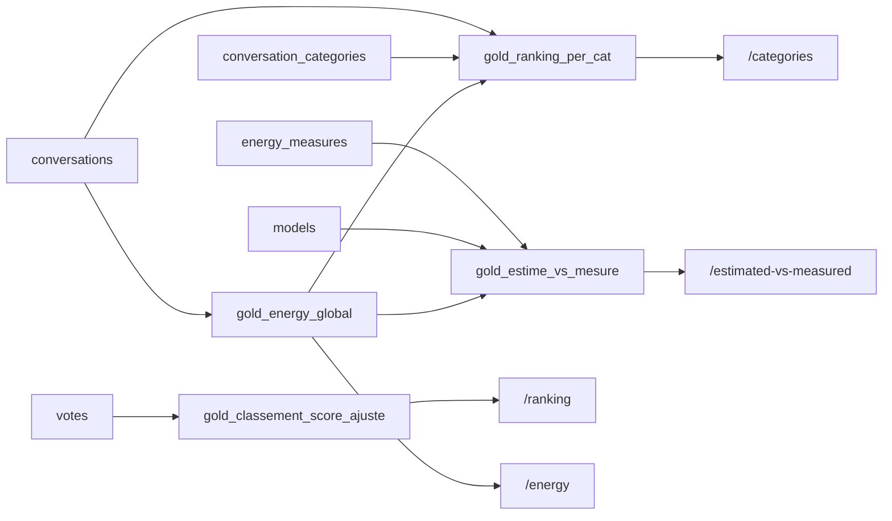

# Tables et vues SQL : schémas et exemples

Aperçu dans VS Code : **Cmd + Shift + V**.
Toutes les lignes d'exemple sont de vraies valeurs (base du 11/10/2026). Les identifiants de conversation sont raccourcis (`5d93f3…`).

## Vue d'ensemble

| Couche | Objet | Produit par | Lignes |
|---|---|---|---|
| Silver | 5 **tables** (données nettoyées) | `clean.py` puis `load_bigquery.py` (`sql/create_tables.sql`) | 122 à 884 364 |
| Gold | 4 **vues** (requêtes enregistrées, recalculées à chaque lecture) | `sql/queries/*.sql` | 23 à 2 635 |
| API | endpoints qui lisent les vues et appliquent les seuils | `api/main.py` | — |

---

# Couche silver : les 5 tables

## `models` (122 lignes) : une ligne par modèle ComparIA
Clé primaire : `model_name`

| model_name 🔑 | total_params | active_params | provider |
|---|---|---|---|
| gemma-3-4b | 4.0 | 4.0 | Google |
| phi-4 | 14.0 | 14.0 | Microsoft |
| claude-4-5-sonnet | 440.0 | 137.0 | Anthropic |

Paramètres en milliards. `active_params` < `total_params` pour les modèles « mixture of experts » (seule une partie du modèle travaille pour chaque token).

## `conversations` (409 977 lignes) : une ligne par duel
Clé primaire : `conversation_pair_id` · Clés étrangères : `model_a_name`, `model_b_name` → `models`

| conversation_pair_id 🔑 | timestamp | model_a_name 🔗 | model_b_name 🔗 | total_conv_a_kwh | total_conv_b_kwh | total_conv_a_output_tokens | total_conv_b_output_tokens | conv_turns |
|---|---|---|---|---|---|---|---|---|
| 5d93f3… | 2025-03-26 09:18 | gemma-3-4b | phi-4 | 0.000073 | 0.000059 | 866 | 611 | 1 |
| 603fd1… | 2025-03-28 11:00 | gemma-3-4b | phi-4 | 0.000114 | 0.000102 | 1 349 | 1 056 | 1 |

## `conversation_categories` (884 364 lignes) : une ligne par couple (conversation, catégorie)
Clé primaire : (`conversation_pair_id`, `category`) · Clé étrangère : `conversation_pair_id` → `conversations`

| conversation_pair_id 🔑🔗 | category 🔑 |
|---|---|
| 5d93f3… | Food & Drink & Cooking |
| 603fd1… | Entertainment & Travel & Hobby |
| 603fd1… | Culture & Cultural geography |

La conversation 603fd1… a **deux** catégories, donc deux lignes. Créée par `clean.py` (`explode` de la colonne `categories` du fichier brut).

## `votes` (149 183 lignes) : une ligne par vote
Clé primaire : `conversation_pair_id` · Clés étrangères : `model_a_name`, `model_b_name`, `chosen_model_name` → `models`

| conversation_pair_id 🔑 | timestamp | model_a_name 🔗 | model_b_name 🔗 | chosen_model_name 🔗 | both_equal |
|---|---|---|---|---|---|
| 8a5552… | 2025-05-19 11:48 | gemma-3-4b | phi-4 | gemma-3-4b | false |
| b12108… | 2025-11-10 10:43 | gemma-3-4b | phi-4 | gemma-3-4b | false |

`chosen_model_name` vide + `both_equal = true` = égalité.

## `energy_measures` (80 lignes) : une ligne par mesure AI Energy Score
Clé primaire : (`hf_model_id`, `task`, `reasoning_level`) · Clé étrangère : `model_name` → `models` (vide si le modèle n'est pas dans ComparIA)

| hf_model_id 🔑 | task 🔑 | reasoning_level 🔑 | gpu_energy_wh | energy_score | size_class | test_date | model_name 🔗 | match_type |
|---|---|---|---|---|---|---|---|---|
| openai-community/gpt2 | text_generation | default | 0.002146 | 5 | A | 2025-02-01 | *(vide)* | *(vide)* |
| google/gemma-3-4b-pt | text_generation | default | 0.034387 | 4 | A | 2025-12-01 | gemma-3-4b | version_base |
| google/gemma-3-4b-pt | reasoning | default | 11.811180 | 1 | A | 2025-12-01 | gemma-3-4b | version_base |
| openai/gpt-oss-20b | reasoning | low | 1.135590 | 5 | B | 2025-12-01 | gpt-oss-20b | exact |
| openai/gpt-oss-20b | reasoning | medium | 4.122110 | 5 | B | 2025-12-01 | gpt-oss-20b | exact |
| openai/gpt-oss-20b | reasoning | high | 5.512010 | 4 | B | 2025-12-01 | gpt-oss-20b | exact |

Pourquoi trois colonnes dans la clé : gemma-3-4b-pt a deux lignes (deux **tâches**) et gpt-oss-20b trois lignes (trois **niveaux de raisonnement** pour la même tâche). Aucune colonne seule, ni aucune paire, ne suffit à distinguer toutes les lignes.
`gpu_energy_wh` = Wh pour **une** requête (le leaderboard affiche × 1000, soit Wh pour 1 000 requêtes).

---

# Couche gold : les 4 vues

Les étapes intermédiaires (`WITH … AS`) n'existent que pendant le calcul : seul le résultat final est visible dans BigQuery.

## Vue 1 : `gold_classement_score_ajuste` (122 lignes)

**Source :** `votes`

**Étape `participations`** : `UNION ALL` des côtés A et B → chaque vote devient deux lignes (298 366 lignes)

| model | chosen_model_name | both_equal | points attribués (`CASE WHEN`) |
|---|---|---|---|
| gemma-3-4b | gemma-3-4b | false | 1 (victoire) |
| phi-4 | gemma-3-4b | false | 0 (défaite) |
| gemma-3-4b | *(vide)* | true | 0,5 (égalité) |
| phi-4 | *(vide)* | true | 0,5 (égalité) |

⬇️ **Étape `model_points`** : `SUM(points)`, `COUNT(*)`, `GROUP BY model`

| model | points | duels |
|---|---|---|
| gemini-2.0-flash | 4130 | 6386 |

⬇️ **Résultat** : score = points ÷ duels × 100 ; ic = 1,96 × √(p(1−p)/n) × 100

| model | points | duels | score | ic | score_min | score_max |
|---|---|---|---|---|---|---|
| gemini-2.0-flash | 4130 | 6386 | 64.67 | 1.17 | 63.50 | 65.85 |
| deepseek-v3-chat | 2309 | 3605 | 64.05 | 1.57 | 62.48 | 65.62 |
| gemma-2-27b-it-q8 | 371 | 598 | 62.04 | 3.89 | 58.15 | 65.93 |

⬇️ **API `/ranking`** : `WHERE duels >= @min_duels` (200 par défaut) `ORDER BY score DESC` → 114 modèles

## Vue 2 : `gold_energy_global` (115 lignes)

**Source :** `conversations`

**Étape `sides`** : `UNION ALL` des côtés A et B → une ligne par (modèle, conversation) (819 954 lignes)

| model | kwh | tokens | conv_turns |
|---|---|---|---|
| gemma-3-4b | 0.000073 | 866 | 1 |
| phi-4 | 0.000059 | 611 | 1 |

⬇️ **Étape `valid_sides`** : `WHERE kwh IS NOT NULL AND tokens > 0` → on retire les 4 modèles sans énergie et les 5 966 réponses vides

⬇️ **Étape `per_model`** : `AVG`, `COUNT`, `SUM`, `GROUP BY model`

| model | avg_kwh | nb_conversations | avg_turns | total_tokens | total_kwh |
|---|---|---|---|---|---|

⬇️ **Résultat** : kWh par requête = avg_kwh ÷ avg_turns ; mWh/token = Σ kWh ÷ Σ tokens × 1 000 000

| model | avg_kwh | nb_conversations | avg_turns | avg_kwh_per_req | total_tokens | mwh_per_token |
|---|---|---|---|---|---|---|
| gemma-3-4b | 0.00010 | 19 908 | 1.49 | 0.00007 | 24 758 140 | 0.0843 |
| gemma-3-27b | 0.00015 | 18 814 | 1.50 | 0.00010 | 25 580 824 | 0.1122 |
| llama-3.1-405b | 0.00923 | 20 165 | 1.49 | 0.00618 | 20 379 510 | 9.1338 |

⬇️ **API `/energy`** : `WHERE nb_conversations >= 200 AND avg_kwh >= 0.00001` → 112 modèles

## Vue 3 : `gold_ranking_per_cat` (2 635 lignes)

**Sources :** `conversation_categories` + `conversations` + vue `gold_energy_global`

**Étape `model_categories`** : `JOIN conversations USING (conversation_pair_id)` pour récupérer les modèles, puis `UNION ALL` des côtés A et B

| model | category |
|---|---|
| gemma-3-4b | Entertainment & Travel & Hobby |
| phi-4 | Entertainment & Travel & Hobby |
| gemma-3-4b | Culture & Cultural geography |
| phi-4 | Culture & Cultural geography |

⬇️ **Étape `counts`** : `COUNT(*)`, `GROUP BY model, category`

| model | category | nb_conv_cat |
|---|---|---|
| lfm2-8b-a1b | Sports | 127 |

⬇️ **Résultat** : `JOIN gold_energy_global USING (model)` → l'énergie du modèle est collée sur chacune de ses lignes ; les modèles sans énergie disparaissent

| model | categories | nb_conv_cat | mwh_per_token | avg_kwh | avg_kwh_per_req |
|---|---|---|---|---|---|
| lfm2-8b-a1b | Sports | 127 | 0.0807 | … | … |
| lfm2-24b-a2b | Sports | 17 | 0.0819 | … | … |
| gpt-oss-20b | Sports | 168 | 0.0831 | … | … |

⬇️ **API `/categories`** : `WHERE nb_conv_cat >= 30` (lfm2-24b-a2b, 17 conversations, est retiré) → 1 976 lignes

## Vue 4 : `gold_estime_vs_mesure` (23 lignes)

**Sources :** `energy_measures` + `models` + vue `gold_energy_global`

**Étape 1** : `JOIN models ON e.model_name = m.model_name` → les 57 mesures sans modèle ComparIA disparaissent (gpt2, SmolLM…), il en reste 23

⬇️ **Étape 2** : `LEFT JOIN gold_energy_global` → on ajoute l'énergie estimée par ComparIA ; si elle n'existe pas, la ligne reste avec des cases vides

| model | match_type | task | gpu_energy_wh (MESURÉ) | comparia_wh_per_req (ESTIMÉ) | comparia_mwh_per_token |
|---|---|---|---|---|---|
| gemma-3-4b | version_base | text_generation | 0.0344 | 0.0705 | 0.0843 |
| gemma-3-4b | version_base | reasoning | 11.8112 | 0.0705 | 0.0843 |
| phi-4 | exact | text_generation | 0.0287 | 0.0540 | 0.0964 |
| ministral-8b-instruct-2410 | exact | text_generation | 0.0209 | *(vide)* | *(vide)* |

`comparia_wh_per_req` = `avg_kwh_per_req × 1000` (kWh → Wh), pour comparer dans la même unité que `gpu_energy_wh`.
Colonnes supplémentaires non affichées : provider, total_params, hf_model_id, reasoning_level, size_class, nb_conversations.

⬇️ **API `/estimated-vs-measured`** : `WHERE task = @task` (text_generation par défaut) → 14 lignes
